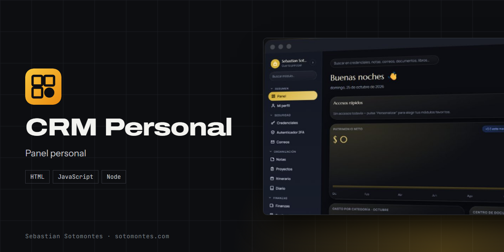
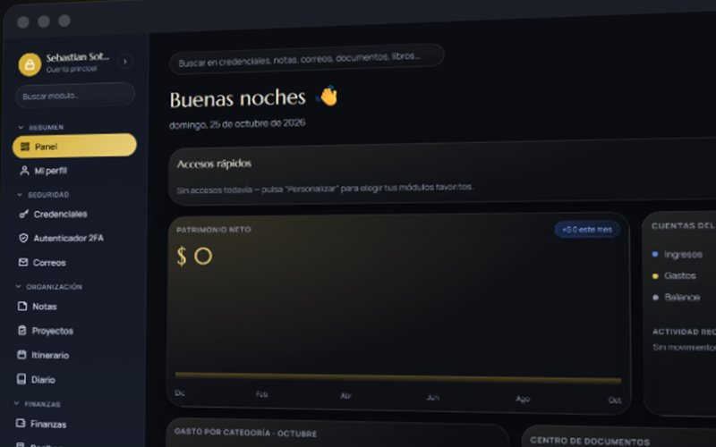
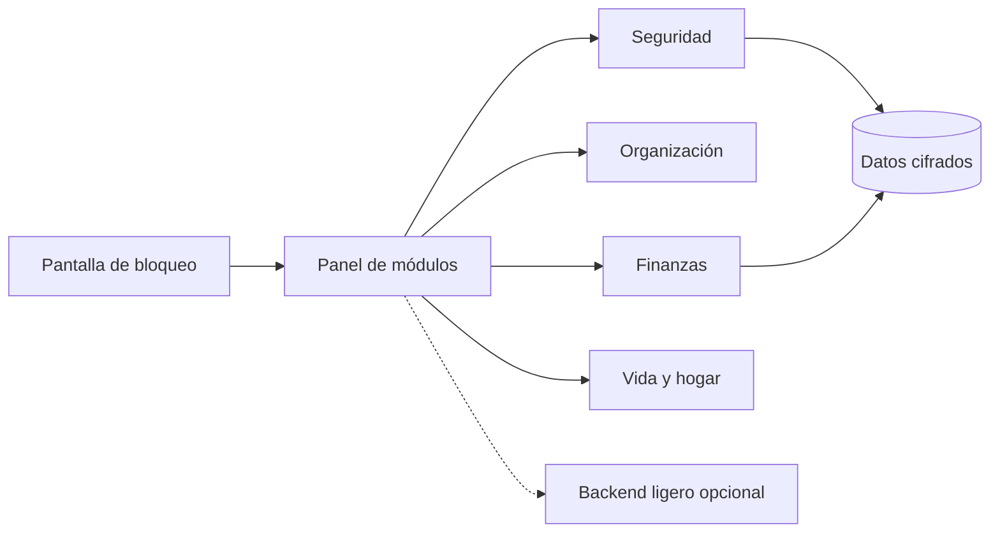

Panel personal todo en uno: credenciales, 2FA, notas, proyectos, finanzas, recibos y suscripciones.

<a href="https://sotomontes.com/#crm-personal"><b>Ver en sotomontes.com</b></a> · <a href="#cómo-se-usa">Cómo se usa</a> · <a href="#cómo-funciona-por-dentro">Cómo funciona</a> · <a href="#novedades">Novedades</a>

| Ficha técnica | |
|---|---|
| **Autor** | Sebastian Sotomontes |
| **Tipo** | Panel personal |
| **Plataforma** | Navegador web, sin instalación |
| **Versión** | 1.0 |
| **Estado** | Funcional |
| **Stack** | HTML · JavaScript · Node |
| **Código** | Privado. Esta página es solo una presentación. |

---

## Qué es

CRM Personal es un panel privado para organizar la vida en un solo lugar: contraseñas, códigos 2FA, finanzas, notas, proyectos, viajes y documentos. Funciona como un escritorio con módulos, y lo sensible se guarda cifrado.

## Novedades

- Panel con patrimonio, gastos y recordatorios.

## Cómo se usa

1. Elige tu perfil en la pantalla de bloqueo y escribe tu contraseña.
2. Revisa el **Panel**: patrimonio, cuentas del mes, gasto por categoría y recordatorios.
3. Añade tus accesos rápidos con **Personalizar**.
4. Entra a un módulo desde el menú lateral, por ejemplo Credenciales, Finanzas o Notas.
5. Usa la búsqueda global para encontrar cualquier dato.

## Funciones

- **Seguridad**: credenciales, autenticador 2FA y correos importantes.
- **Organización**: notas, proyectos, itinerario y diario.
- **Finanzas**: movimientos, patrimonio neto, recibos y suscripciones.
- **Vida y hogar**: viajes, lectura y documentos.
- **Datos cifrados**, pantalla de bloqueo y búsqueda global.

## Detalles

- Seguridad: credenciales, autenticador 2FA y correos importantes.
- Organización: notas, proyectos, itinerario y diario.
- Finanzas: movimientos, patrimonio, recibos y suscripciones.
- Vida y hogar: viajes, lectura y documentos.

## Privacidad y seguridad

Credenciales y códigos 2FA quedan cifrados y se abren con la contraseña del perfil.

## Cómo funciona por dentro

### Flujo

### Cómo funciona

La app arranca en una **pantalla de bloqueo**: eliges tu perfil y escribes la contraseña. A partir de ahí navegas
por **módulos** (credenciales, finanzas, notas…), cada uno con su propia vista dentro de un panel tipo escritorio.
La información se guarda **cifrada**, de modo que lo sensible (contraseñas, 2FA, diario) no queda en texto plano.
Puede funcionar como una sola página con almacenamiento local, o apoyarse en un backend ligero (**Node** o **PHP**)
para sincronizar/servir los datos.

### Estructura

| Carpeta | Contenido |
|---|---|
| `app/` | Interfaz (HTML/CSS/JS) |
| `server/` | Backend en **Node** |
| `server-php/` | Backend alternativo en **PHP** |
| `_ds/` | Recursos de diseño |

> personales. Aquí está solo el **código fuente**.

### Tecnologías

- **HTML + CSS + JavaScript** (sin framework) en el cliente.
- Backend opcional en **Node** o **PHP** (dos implementaciones intercambiables).
- Cifrado de los datos sensibles en el almacenamiento local.

### Seguridad

- La bóveda guarda credenciales y códigos 2FA **cifrados**; se abre con la contraseña del perfil.

---

© 2026 Sebastian Sotomontes. Todos los derechos reservados.
